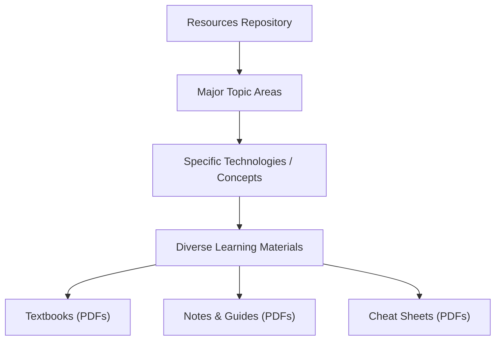

# 🚀 Resources

<p align="center">
  <a href="https://github.com/Sanika2103/Resources/stargazers"></a>
  <a href="https://github.com/Sanika2103/Resources/network/members"></a>
  <a href="https://github.com/Sanika2103/Resources/issues"></a>
</p>

## Short Description

Dive into a meticulously curated collection of essential learning materials for every aspiring and seasoned software developer! This repository serves as a comprehensive knowledge hub, packed with insightful PDFs, guides, and notes covering the vast landscape of computer science, programming languages, and cutting-edge technologies. From foundational algorithms to advanced blockchain concepts, empower your learning journey with readily accessible, high-quality resources.

## ✨ Key Features

*   **Comprehensive Curriculum:** Explore a broad spectrum of topics including Algorithms, Data Structures, Web Development, Mobile Development (Android, Flutter), Data Science, Machine Learning, Cyber Security, and more.
*   **Organized for Clarity:** Resources are neatly categorized into intuitive folders, making it effortless to find exactly what you need for your current learning objectives.
*   **Rich Content Formats:** Access a diverse array of learning materials, including in-depth textbooks, concise notes, cheat sheets, and detailed guides.
*   **Multi-Language Support:** Delve into popular programming languages such as C, C++, Java, Python, JavaScript, Go, Kotlin, PHP, R, and Swift, each with dedicated learning paths.
*   **Foundational to Advanced:** Whether you're a beginner grasping core concepts or a professional seeking to master advanced domains like Kubernetes or Natural Language Processing, this repository has you covered.

## Who is this for?

*   **Computer Science Students:** A valuable companion for coursework, exam preparation, and deepening understanding.
*   **Aspiring Developers:** Kickstart your journey into programming and software development with structured learning paths.
*   **Experienced Engineers:** Refresh your knowledge, explore new technologies, or quickly reference complex topics.
*   **Self-Learners:** Perfect for anyone committed to continuous learning and professional development in the tech industry.

## Technology Stack & Architecture

This repository is a testament to the diverse world of technology. It doesn't implement a "stack" in the traditional sense, but rather *documents* and *explores* a vast array of them. The "architecture" here refers to the knowledge domains covered:

**Programming Languages:** C, C++, Java, Python, JavaScript, Go, Kotlin, Swift, PHP, R, Solidity

**Core Computer Science:** Algorithms, Data Structures, Object-Oriented Programming (OOP), DBMS, Computer Networks, Operating Systems

**Development Domains:** API Design, Android Development, Flutter, Web Development (HTML, CSS, JavaScript), Blockchain, Competitive Programming, Git, Linux, Kubernetes, Cyber Security

**Data & AI:** Data Science, Machine Learning, Natural Language Processing

## 📊 Architecture & Database Schema

This project is structured as a hierarchical knowledge base. The "architecture" is its clear, topic-based organization designed for optimal discoverability and learning flow.



## ⚡ Quick Start Guide

Getting started with these invaluable resources is incredibly straightforward:

1.  **Clone the repository:**
    ```bash
    git clone https://github.com/Sanika2103/Resources.git
    ```
2.  **Navigate to the repository directory:**
    ```bash
    cd Resources
    ```
3.  **Explore by topic:** Browse the well-organized folders to find the specific area you're interested in (e.g., `Algorithms`, `Data Structures`, `Web Development`).
4.  **Access Learning Materials:** Open the PDF files directly with your preferred PDF viewer to begin learning!